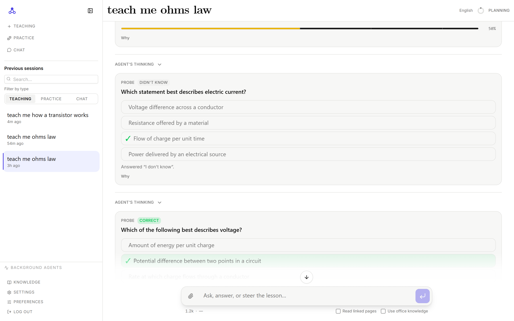
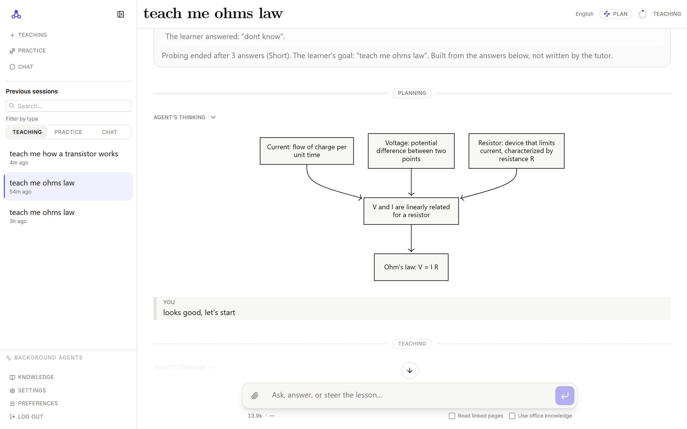
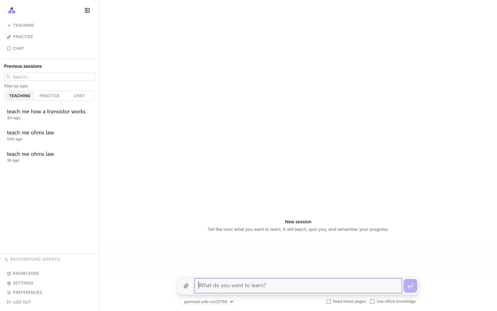

<p align="center">
  <picture>
    <source media="(prefers-color-scheme: dark)" srcset="docs/assets/lh_banner_dark.png">
    <source media="(prefers-color-scheme: light)" srcset="docs/assets/lh_banner_light.png">
    
  </picture>
</p>

<p align="center"><strong>An AI tutor for the office that runs on your own models.</strong></p>

<p align="center">
  <a href="#how-a-session-works">How it works</a> ·
  <a href="#models">Models</a> ·
  <a href="#setup">Setup</a> ·
  <a href="DEPLOY.md">Deployment guide</a>
</p>

LearnHarness Office is a web app that teaches. Tell it what you want to learn. It first checks what you already know, then plans a path to your goal and teaches it one step at a time with questions you answer in the app. Everything runs inside the office: the models are your own (LM Studio, Ollama, or any OpenAI-compatible server), and chats, documents and the knowledge graph stay on the office server.

## How a session works



1. **Probe.** The tutor asks a few diagnostic questions — options to click, or a box to type in — to find where your understanding ends. It does not explain while probing. With **Short** probing (the default) it moves on after your 3rd answer; with **Long** it keeps asking until it decides it knows enough. You choose in Preferences.
2. **Plan.** It draws a dependency map from what you know to your goal and shows it to you. Say "let's start" (or steer it) to begin.
3. **Teach.** Each step builds on the last: an explanation, then a check question. Wrong answers get feedback before the lesson moves on. You can type your thinking next to each answer, so the tutor sees how you reason, not just right or wrong.



Besides **Teaching**, there are **Practice** sessions (problems that draw on what you learned) and **Chat** sessions (plain questions and answers).

## What else it does

- **Web search** — with SearXNG configured, the tutor can search the web in the background and fold what it finds into the lesson (switch it on per session).
- **Office knowledge** — upload PDF, PPTX, DOCX, Markdown or text files to a Personal or a Shared library; sessions can search them.
- **Knowledge graph** — what you are taught is stored as propositions and reasoning chains, so later sessions can build on it.
- **English and Japanese** — interface and teaching language are set per user.
- **Preferences** — Reasoning on/off (slower, more careful answers) and Short/Long probing.
- **Admin** — the account named in `LH_ADMIN_USERNAME` manages users and the shared library at `/admin`.

## Models



You can configure several models, each on its own server. Learners pick one by name on the new-session screen; the session keeps that model for probing, planning, teaching, research and background work.

Any OpenAI-compatible Chat Completions server works (`/v1/chat/completions`). Tested so far:

| Model | Server | Notes |
|---|---|---|
| Gemma 4 (E4B, 12B, 26B-A4B) | Ollama; LM Studio behind `deploy/gemma4-proxy` | The proxy fixes Gemma's thinking and tool-call quirks. |
| gpt-oss (20B tested) | LM Studio | The app applies LM Studio's gpt-oss tool-call fix automatically (by model name). |
| Qwen 3.5 (9B tested) | LM Studio | Works as is. Often asks in plain text, so the app adds one reminder call to get an answer box. |

Other families (GLM, …) should work through the same API but have not been tested end to end yet.

## Setup

Requirements: Node.js 20+ and npm, an OpenAI-compatible model server, and optionally Docker for SearXNG.

```bash
npm install
cp .env.example .env     # then fill it in (see below)
npm run build
npm run start            # serves on PORT (default 3000)
```

The main settings in `.env`:

```env
# Model 1 (the default)
LLM_BASE_URL=http://172.20.1.126:8088/v1     # must end in /v1
LLM_MODEL=<model id, as the server lists it>
LLM_CONTEXT_WINDOW=32768                     # the context the server actually loaded
LLM_MAX_TOKENS=4096
LLM_VISION=false
LLM_REASONING=true

# Model 2, 3, … (optional) — same six settings with a number
LLM_2_BASE_URL=http://<mac-ip>:1234/v1
LLM_2_MODEL=openai/gpt-oss-20b
LLM_2_CONTEXT_WINDOW=32768
LLM_2_MAX_TOKENS=4096
LLM_2_VISION=false
LLM_2_REASONING=true

NO_PROXY=localhost,127.0.0.1,172.20.1.126,<mac-ip>   # every model host
SESSION_SECRET=<at least 32 random characters>
LH_ADMIN_USERNAME=<your admin username>
SEARCH_PROVIDER=searxng
SEARXNG_URL=http://127.0.0.1:8080
```

`npm run smoke:llm` checks that model 1 answers and can call a tool. [DEPLOY.md](DEPLOY.md) covers the server install, SearXNG, the systemd service, picture reading and upgrades.

## Development

```bash
npm run dev        # http://localhost:3000
npm test           # deterministic: no model, no network
npm run typecheck
```

See [docs/development.md](docs/development.md) and [docs/architecture.md](docs/architecture.md).

## License

[AGPL-3.0](LICENSE). Based on [LearnHarness](https://github.com/amosblomqvist/learnharness) by Amos Blomqvist.
